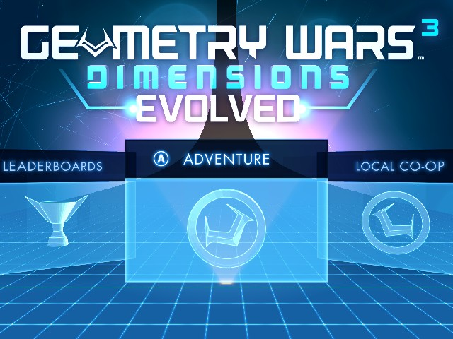
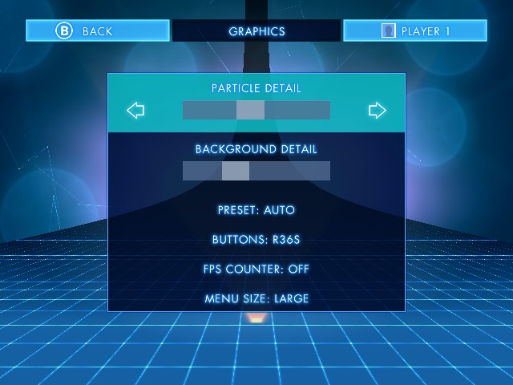
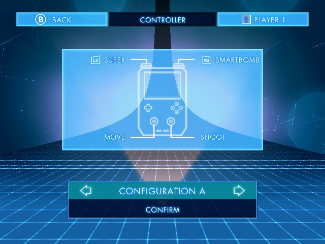
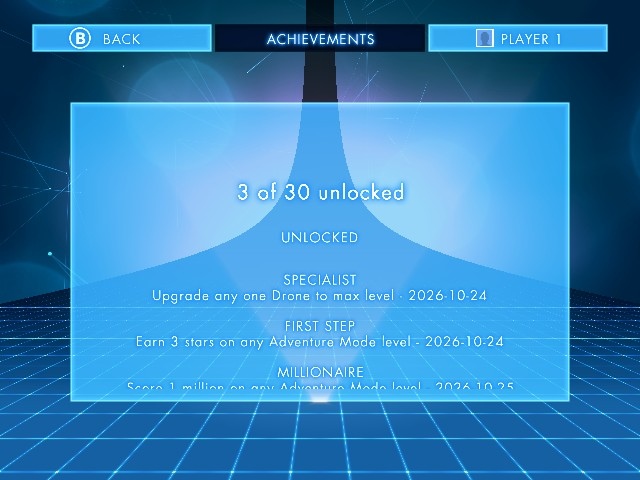
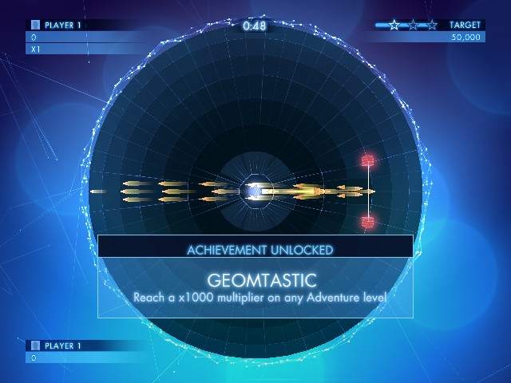
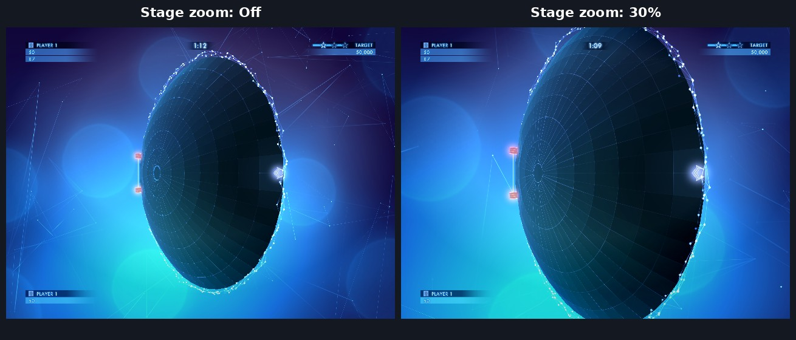
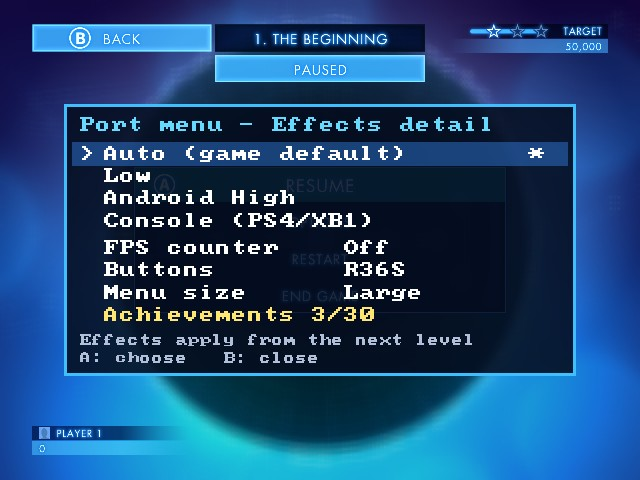

# Geometry Wars 3: Dimensions Evolved for R36S

**Geometry Wars 3: Dimensions Evolved on the R36S and other RK3326 Linux handhelds, through PortMaster.** A
native port of the Android version: the game's original ARM engine runs directly on the handheld, with no
emulation and no Box86.

Built on [gw3-portmaster](https://github.com/GreekAdonis/gw3-portmaster) by GreekAdonis, whose loader does the
hard part: running the Android engine on Linux. This version adds the 1.3.0 "Evolved" release, R36S controls and
the features from the [Switch port](https://github.com/Theonesabove/gw3nx).

> **Bring your own game.** This repository contains no game code or assets. You need your own copy of the
> Android version of Geometry Wars 3: Dimensions (the APK and its OBB data file).



<table>
  <tr>
    <td> Graphics"></td>
    <td></td>
  </tr>
  <tr>
    <td></td>
    <td></td>
  </tr>
  <tr>
    <td></td>
    <td></td>
  </tr>
</table>

<sub>All screenshots are 640×480, the R36S's resolution. They were taken from a PC build of the same game code
with the same changes; the port menu shot is a close preview of the real one.</sub>

## Features

- **The full 1.3.0 "Evolved" game** with its console interface: Adventure, Local Co-op, Hardcore, Classic,
  Ultimate, Options and Achievements, all driven by the controls, plus the 41 Evolved levels. 1.0.0 also runs,
  with the phone menus.
- **Menus sized for the 4:3 screen**: the console menus are built for 16:9 TVs and came out at three-quarter
  size on the R36S. They're now about 33% bigger and fill the screen, with the title bar and HUD kept inside
  the edges. You can switch back to the original size.
- **R36S controls**: A confirms and B goes back, matching the button labels, and the d-pad works in every menu.
  The on-screen icons show L1 / R1 / L2 / R2, and the Controller page shows a handheld with the R36S layout.
- **Options > Graphics**, a new page inside the game's own Options screen:
  - **Particle detail** and **Background detail** sliders.
  - **Preset**: Auto (what the game picks for the device), Low, Android High or Console (the PS4 / Xbox One
    values).
  - **Buttons**: R36S or Xbox layout.
  - **FPS counter**, **Menu size** (Large or Normal) and **Stage zoom**.
- **Stage zoom** (optional): Off, 10%, 20% or 30%. The arena and everything in it is drawn bigger and the camera
  follows your ship, but you see less of the arena at once. It applies immediately.
- **Offline achievements**: all 30 are tracked on the SD card, shown on the game's own Achievements screen, with
  an unlock pop-up in the game's style. No Google Play needed.
- **Port menu**: hold **SELECT** for 1 second for quick effect presets, the FPS counter, button layout, menu
  size, stage zoom and a compact achievements list.
- **Sound fixed**: the original port turned off the game's sound commands to avoid a crash at startup. They're
  back on, and only the call that crashed is skipped.
- **Saves** for both versions, including 1.3.0's "cloud" save, kept locally. Quit in the game's menu returns
  to the frontend.

## Requirements

- An R36S or another RK3326 handheld with [PortMaster](https://portmaster.games). Tested on dArkOS.
- Your own copy of the Android game:
  - the APK, or an `.xapk` / `.apkm` bundle
  - the OBB data file: `main.101.com.activision.gw3.dimensions.obb` for **1.3.0** (recommended), or
    `main.35.com.activision.gw3.dimensions.obb` for 1.0.0

Keep the files of one version only: the port uses the newest OBB it finds, and the APK must match it.

## Installation

1. Download `gw3.zip` from the [Releases](../../releases) page and unzip it into your `ports` folder.
2. Copy your APK and the OBB into `ports/gw3/`. On a phone, the OBB lives in
   `Android/obb/com.activision.gw3.dimensions/`.
3. Launch **Geometry Wars 3** from Ports.

On the first launch the launcher extracts `libgwnext.so`, `libfmodex.so` and `libfmodevent.so` from the APK by
itself; you don't need to open the APK.

## Controls

| Button | Menus | In a level |
|---|---|---|
| Left stick / d-pad | Move the selection | Move |
| Right stick | | Shoot |
| A | Confirm | |
| B | Back | |
| L2 | | Super |
| R2 | | Smart bomb |
| START | | Pause |
| SELECT (hold 1 s) | Port menu | Port menu |
| START + SELECT | Quit | Quit |

If A and B come out swapped on your firmware, set **Options > Graphics > Buttons** to **Xbox**.

## Files on the SD card

Everything lives in `ports/gw3/`:

| File | What it is |
|---|---|
| `savegame.dat`, `cloudsave.bin` | Your save (written by the game) |
| `gw3.ini` | Port settings: effect detail, buttons, FPS counter, menu size, stage zoom |
| `achievements.txt` | Unlocked achievements and their dates |
| `gw3.log` | The log of the last run; attach it to bug reports |

## Versions of the game

| | 1.0.0 (builds 35 / 41) | 1.3.0 "Evolved" (build 101) |
|---|---|---|
| Interface | Phone UI, touch-first | TV / console UI, controller-first |
| Evolved level pack | Not included | 41 extra levels |
| Main menu | Phone menus | Ring with Adventure, Local Co-op, Hardcore, Classic, Ultimate, Leaderboards, Options, Achievements |
| Data file | `main.35…obb` | `main.101…obb` |
| Graphics page, larger menus | Not available (use the port menu) | Yes |

## Known limitations

- **Online features** (online leaderboards, friends' scores, Facebook, cloud sync) need servers that no longer
  exist, so they are off.
- **Changing the menu size** takes effect the next time you start the game.
- **Higher stage zoom** shows less of the arena, so enemies can come from off-screen.
- **One player**: the built-in controls only.
- **Achievement names** follow the game's internal order matched to the public achievement list; if an unlock
  shows the wrong name, please open an issue.

## Troubleshooting

- **The game closes or freezes**: open an issue and attach `ports/gw3/gw3.log`.
- **"Installation incomplete" on launch**: check that the APK and the OBB are in `ports/gw3/`, and that they're
  the same version.
- **A and B are swapped**: set Options > Graphics > Buttons to Xbox, or Buttons in the port menu.

## Building

### Quick build (no Docker, no armhf packages)
On an x86-64 Ubuntu or Debian host:
```sh
sudo apt-get install -y gcc-arm-linux-gnueabihf libsdl2-dev libgles-dev libegl-dev zlib1g-dev
scripts/cross-build.sh   # -> gw3.pm and libclock_fix.so
```
It downloads glibc 2.31 for armhf (Ubuntu 20.04's `libc6-dev-armhf-cross`) into `focal-sysroot/`, reuses the
host's SDL2 / GLES / EGL / zlib headers and links against stub libraries; the device supplies the real ones. The
binary needs glibc 2.29 or newer, so it runs on every current PortMaster firmware.

### With armhf packages or Docker
```sh
make portmaster            # with libsdl2-dev:armhf, libgles2-mesa-dev:armhf, libegl1-mesa-dev:armhf, zlib1g-dev:armhf
./docker-make.sh portmaster
```

### The PortMaster zip
The GitHub Actions workflow (`.github/workflows/build.yml`) builds everything and attaches `gw3.zip` to a
release when you push a tag. By hand: copy `gw3.pm` to `gw3-portmaster/gw3/gw3` and `libclock_fix.so` into
`gw3-portmaster/gw3/`, then zip `Geometry Wars 3.sh` and `gw3/` from inside `gw3-portmaster/`.

To redraw the button prompts and the Controller page diagram: `python3 tools/make_prompts.py` (needs Pillow and
the DejaVu fonts).

### Debug options (environment variables)
`GW3_PHONE=1` uses 1.3.0's phone menus, `GW3_STOCK=1` shows the game's own menus and prompts,
`GW3_XBOX_LAYOUT=1` uses the Xbox button layout, `GW3_TRACE_ASSETS=1` logs every file the game opens,
`GW3_INPUTLOG=1` logs the controls, `GW3_ACHTEST=900:5` unlocks achievement 5 at frame 900.

## How it works

The Android game is a 32-bit ARM library (`libgwnext.so`) plus FMOD. gw3-portmaster loads it with its own ELF
loader into a small Linux program that stands in for the parts of Android the game expects: the Java side
(JNI), bionic libc and pthreads, the APK/OBB asset system, OpenGL ES with soft-float to hard-float thunks, and
OpenSL audio for FMOD.

| Piece | File |
|---|---|
| Loader, libc / bionic shims, crash reports, controls, game hooks | `src/main.c` |
| ELF loader and function hooks | `src/so_util.c` |
| Fake Java VM and JNIEnv, the game's startup sequence, 1.3.0 console mode and cloud save | `src/jni_patch.c` |
| Asset manager over the OBB archive | `src/aasset_patch.c` |
| OpenGL ES bridge | `src/opengl_patch.c` |
| FMOD loading, OpenSL ES → SDL2 audio | `src/fmod_patch.c`, `src/fmod_opensl.c` |
| Graphics page, achievements, port menu, prompts, larger menus, stage zoom, sound fix | `src/qol.c` |
| Button prompts and the Controller page diagram | `tools/make_prompts.py` → `src/prompts.inc` |

Notes on the additions in `src/qol.c`:

- **Hooks that keep the original**: `hook_wrap()` copies an engine function's first two ARM instructions into a
  trampoline (refusing any that read the program counter) and points the function at the port's code, which can
  still call the original. The Options page is built this way, from the game's own menu widgets.
- **Larger menus**: the console UI is a 640×360-unit canvas seen by a 3D camera with a 45° field of view
  (`CalculateUiTransformMatrix`). On narrower screens `GameApp::SetWindowSize` keeps all 640 units of width. The
  port narrows the camera by up to 4/3, shrinks the canvas to what is then visible, and corrects
  `TitleBar_GetScreenEdgeMargin`, which uses the safe area as a margin from the canvas edge.
- **Stage zoom**: the stage camera's field of view is `gMapZoom × 0.6283`. That constant, and the intro camera's
  copy in `C_LuaCamera::CalculateFov`, are divided by the zoom. Both game versions' locations are checked before
  writing.
- **Achievements list**: the Credits screen is fed the achievements in its own XML format. The game appends to
  one global list on every visit (`creditsVector`), so the port empties it first.
- **Sound fix**: a three-instruction guard runs ahead of each of the 25 `Audio::C_AudioSystem` command methods,
  so they're skipped only when the audio system doesn't exist yet.

Each patch tied to a game build checks its target first and leaves the game as it is on another build.

## Credits

- **Thanks to [GreekAdonis](https://github.com/GreekAdonis) for [gw3-portmaster](https://github.com/GreekAdonis/gw3-portmaster)**,
  the Linux loader this port is built on: the ELF loader, the Android runtime stand-ins, the OBB reader, the
  graphics and audio bridges, the launcher and the build. None of this would run without it.
- [gtactw_vita](https://github.com/TheOfficialFloW/gtactw_vita) by TheOfficialFloW (MIT), the loader
  gw3-portmaster's is based on.
- [gw3nx](https://github.com/Theonesabove/gw3nx), the Switch port, where the 1.3.0 support and the extras were
  first built.
- [stb_image](https://github.com/nothings/stb) and [font8x8](https://github.com/dhepper/font8x8), both public
  domain.
- The L1 / R1 / L2 / R2 prompts and the Controller page diagram are original drawings made for this port
  (`tools/make_prompts.py`).

Geometry Wars 3: Dimensions is © Activision and Lucid Games. This is an unofficial fan project, not affiliated
with or endorsed by Activision or Lucid Games.
